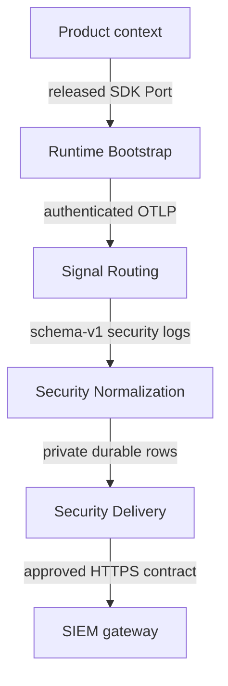

# Architecture

Status: Proposed while PR #1 remains unmerged and unreleased.

## Responsibility boundary

The Telemetry subdomain contains four bounded contexts:

| Bounded context | Responsibility | Owned interface/data |
| --- | --- | --- |
| Runtime Bootstrap | Explicit, inert SDK configuration and bounded product-facing Ports | `TelemetryConfig`, `TelemetryEvent`, `TelemetryRuntime` |
| Signal Routing | Authenticated OTLP admission and operational/security separation | `collector/production.yaml` |
| Security Normalization | Tenant-bound schema-v1 validation and durable idempotent admission | HTTPS `/v1/logs`; private `security_event_outbox` |
| Security Delivery | Bounded handoff to an operator-approved SIEM gateway | HTTPS `/v1/security-events`; exact acknowledgement |

Product bounded contexts are upstream customers. They own Ubiquitous Language,
domain event truth, authorization, authoritative audit records, and retention
decisions. This repository supplies an Anti-Corruption Layer to OpenTelemetry
and SIEM protocols; transport never becomes product truth.

## Context map

No consumer may read the outbox, import a temporary branch, or share Collector
credentials. Before an immutable release, consumers use a disabled feature flag
or a contract test double.

## Domain model and invariants

- `TelemetryConfig` is a validated Value Object. Receiver configuration is
  HTTPS-only, bearer-authenticated, and bounded.
- `TelemetryEvent` is a product-facing Value Object with finite names,
  purposes, classifications, kinds, and attributes.
- A normalized security event is the aggregate admitted under one
  authenticated tenant and one stable event ID.
- `security_event_outbox` is the aggregate store. State 0 is pending, state 1
  is exactly acknowledged, and state 2 is quarantined after an authenticated
  event-specific permanent rejection.
- Equal retries are idempotent. Reuse of an event ID with different content is
  rejected.
- Ambiguous network, TLS, redirect, HTTP, or acknowledgement failure cannot
  advance delivery state.
- Importing `cwl_telemetry` creates no provider, thread, socket, or process.
- All wire inputs, queues, label vocabularies, batches, counters, request
  bodies, and deadlines are bounded.

SQLite is deliberately private and minimal. The receiver and scheduled sender
are the only writers. If measured concurrency outgrows this boundary, first
scale one receiver/outbox per tenant; adopt a new durable service only through
an ADR and migration contract.

## Runtime and deployment topology

The product explicitly creates isolated providers. The Collector receives OTLP
over TLS with bearer authentication, routes operational logs/traces/metrics to
the configured backend, and serializes security records to the tenant-bound
normalizer. The normalizer commits before acknowledging the Collector. A
separate operator-scheduled sender attempts one bounded batch and marks only
exactly acknowledged rows delivered.

The production template requires a persistent `/var/lib/otelcol` volume and
mounted credentials. Backend and security-consumer destinations are deployment
inputs; template presence is not proof that either destination is safe or
deployed.

## Failure scenes

| Scene | Required behavior |
| --- | --- |
| SDK exporter unavailable | Product work continues; bounded drop/failure accounting remains observable |
| Collector restarts | Persistent queue recovers without route mixing |
| Receiver sees a slow or malformed client | One absolute request deadline and bounded body fail closed |
| Duplicate event arrives | Equal content is replay-safe; conflicting content is rejected |
| SIEM is unavailable or redirects | Row remains pending and credential is not forwarded |
| SIEM rejects one event with exact 400/422 document | Row becomes quarantined; later rows may proceed; exit status requires operator attention |
| Process stops after remote acceptance but before local mark | Idempotency key permits safe replay |
| Outbox reaches capacity | Receiver returns unavailable; no record is silently overwritten |

## Release boundary

Acceptance requires terminal exact-head contract/security checks, independent
approval, normal merge to protected `main`, immutable artifacts and hashes,
and a consumer parity test against the released interface. Local builds,
predecessor checks, Draft releases, or branch URLs do not satisfy this boundary.
